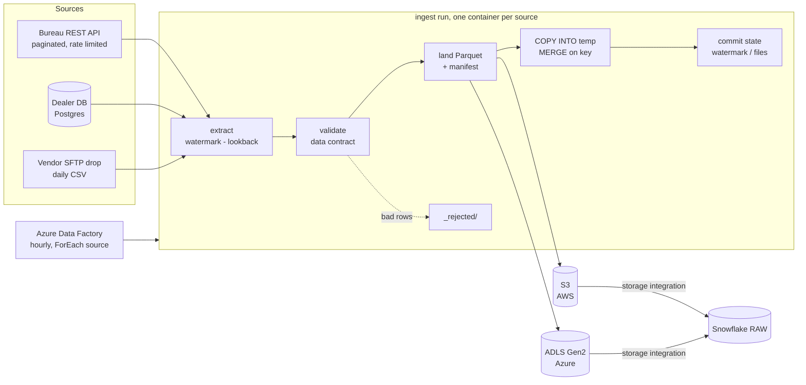

# Multi-Cloud Ingestion Framework (AWS + Azure → Snowflake)

[](https://github.com/Kolli-Jahnavi-07/multicloud-ingestion-framework/actions/workflows/ci.yml)

**Stack:** Python · AWS S3 + IAM · Azure Data Lake Storage Gen2 · Azure Data Factory · Snowflake (COPY INTO, MERGE, external stages) · Terraform · Parquet / PyArrow · SQLAlchemy · Docker · GitHub Actions

One framework ingests every source the same way: **REST APIs, relational databases and vendor file drops** are extracted incrementally, checked against a data contract, landed as Parquet in **S3 or ADLS Gen2**, and merged into **Snowflake**. Adding a feed is a YAML entry, not new code.



## Why it's built this way

**Config over code.** `config/sources.yml` declares each source's connector, landing zone, primary key, incremental column and contract. The Snowflake DDL, the COPY + MERGE and the Airflow tasks are all generated from that file.

**Correct under retries and crashes.** State (watermark, processed files) is saved only after data has landed *and* merged. If the job dies anywhere before that, the next run re-reads the same window, and because every load is a MERGE on the primary key, nothing is duplicated. `test_crash_after_landing_is_recovered_without_duplicates` kills the process between landing and loading and checks the warehouse afterwards.

**Data contracts with sensible failure modes.**

| Situation | What happens |
|---|---|
| A value can't be cast, a required field is null, or a value is outside min / max / allowed | That record goes to `_rejected/` with the reason; the rest of the batch lands |
| More than 5% of a batch is rejected | The whole run fails: something upstream is broken, and partial data would hide it |
| A required column disappears | Run fails before anything lands |
| A new column appears | `evolve`: kept as text, `ALTER TABLE ADD COLUMN` in Snowflake, reported once. `fail`: run stops (used for the vendor feed, whose schema is contractual) |
| The same key twice in one extract | Newest version wins |
| An older version arrives after a newer one | MERGE only updates when the incoming timestamp is newer |

**Incremental everywhere.** APIs and databases read from the last watermark minus a small overlap (`lookback_minutes`) so late-committed rows aren't missed. The overlap is re-read but changes nothing. File drops are tracked by name *and* SHA-256: a re-sent file is skipped, a corrected file under the same name is processed again.

**Resilient API client.** Cursor pagination, retries with exponential backoff on 5xx and connection errors, and `Retry-After` honoured on 429. The demo API returns 429 and 503 on purpose, so this is exercised on every CI run.

**Least privilege, no keys.** Terraform creates an S3 bucket (versioned, encrypted, public access blocked, lifecycle to Glacier IR) and an ADLS Gen2 account with shared keys disabled. Snowflake reads through storage integrations (an IAM role with an external ID on AWS, a consented service principal on Azure). The ingestion job writes with its own role or managed identity.

## Demo

`make demo` starts a real local HTTP API, a SQLite "dealer database" and a vendor drop folder, then runs every source three times:

```
Round 1: first load of every source
source               status       extracted  landed rejected  dupes    ins    upd  notes
credit_applications  succeeded        3,000   2,966       34      0  2,966      0  3 retries over 12 pages
dealers              succeeded          120     120        0      0    120      0
vehicle_valuations   succeeded        2,000   2,000        0      0  2,000      0

Round 2: sources changed (updates, new rows, a new API field, a new vendor file)
credit_applications  succeeded          702     698        4      0    300    396  new columns: channel
dealers              succeeded           17      17        0      0      5     12
vehicle_valuations   succeeded        2,000   2,000        0      0  2,000      0  1 file(s) already processed

Round 3: nothing changed upstream
credit_applications  succeeded           31      31        0      0      0      0
dealers              succeeded           17      17        0      0      0      0
vehicle_valuations   no_new_data          0       0        0      0      0      0  2 file(s) already processed
```

Round 2 reads 702 records instead of 3,300, picks up the API's new `channel` field without a code change, and skips yesterday's vendor file. Round 3 re-reads only the overlap window and writes nothing.

Landing layout (identical on S3 and ADLS):

```
credit_applications/ingest_date=2026-10-17/run_id=20261017T170312-12c1b6/part-0000.parquet
credit_applications/ingest_date=2026-10-17/run_id=20261017T170312-12c1b6/_manifest.json   <- written last
_rejected/credit_applications/ingest_date=2026-10-17/run_id=.../rejected.jsonl
```

The generated Snowflake load for a run (`python -m ingest sql credit_applications <manifest>`):

```sql
ALTER TABLE LOANS.RAW.CREDIT_APPLICATIONS ADD COLUMN IF NOT EXISTS CHANNEL VARCHAR;
CREATE OR REPLACE TEMPORARY TABLE LOANS.RAW.CREDIT_APPLICATIONS__STG LIKE LOANS.RAW.CREDIT_APPLICATIONS;
COPY INTO LOANS.RAW.CREDIT_APPLICATIONS__STG (APPLICATION_ID, ..., CHANNEL, _RUN_ID, _SOURCE_FILE, _INGESTED_AT)
FROM (SELECT $1:"application_id"::VARCHAR, ..., METADATA$FILENAME, CURRENT_TIMESTAMP()
      FROM @RAW.AWS_LANDING/credit_applications/ingest_date=2026-10-17/run_id=.../)
FILES = ('part-0000.parquet') FILE_FORMAT = (TYPE = PARQUET USE_LOGICAL_TYPE = TRUE);
MERGE INTO LOANS.RAW.CREDIT_APPLICATIONS t
USING (SELECT * FROM LOANS.RAW.CREDIT_APPLICATIONS__STG
       QUALIFY ROW_NUMBER() OVER (PARTITION BY APPLICATION_ID ORDER BY UPDATED_AT DESC) = 1) s
ON t.APPLICATION_ID = s.APPLICATION_ID
WHEN MATCHED AND s.UPDATED_AT > t.UPDATED_AT THEN UPDATE SET ...
WHEN NOT MATCHED THEN INSERT ...;
```

## Repository layout

```
config/sources.yml            sources, landings, contracts (env-driven: same file for local and prod)
src/ingest/
  sources/rest.py             paginated API client with retries and Retry-After
  sources/sql.py              incremental SQLAlchemy extract (Postgres / SQLite)
  sources/files.py            file drop with name + checksum tracking
  contracts.py                type coercion, quarantine, drift and reject-rate rules
  storage.py                  local / S3 / ADLS Gen2 behind one interface, chosen by URI
  landing.py                  Parquet + manifest commit marker
  state.py                    watermarks and processed files, saved after load
  loaders/snowflake.py        generated DDL, COPY INTO and MERGE
  loaders/duckdb_loader.py    same semantics locally, for the demo and tests
  runner.py                   extract -> validate -> land -> load -> commit
infra/terraform/aws/          S3 bucket, lifecycle, Snowflake reader role, writer policy
infra/terraform/azure/        ADLS Gen2, retention policy, Data Factory, role assignments
snowflake/stages.sql          storage integrations and external stages for both clouds
orchestration/adf/            Data Factory pipeline (parallel ForEach, alert, fail) and hourly trigger
orchestration/airflow/        Airflow DAG generated from the same sources.yml
demo/                         fake bureau API (real HTTP), SQLite seed, vendor files
tests/                        31 tests
```

## Run it

```bash
pip install -r requirements-dev.txt
make test      # 31 tests, ~15 s
make demo      # three rounds against all sources, local landing + DuckDB warehouse

# against real infrastructure
export LANDING_AWS_URI=s3://acme-loans-landing-prod/raw
export LANDING_AZURE_URI=abfss://landing@acmeloanslakeprod.dfs.core.windows.net/raw
export STATE_URI=s3://acme-loans-landing-prod/_state
export SNOWFLAKE_ACCOUNT=... SNOWFLAKE_USER=... SNOWFLAKE_PRIVATE_KEY_FILE=...
PYTHONPATH=src python -m ingest run --warehouse snowflake
```

## Tests and CI

- **Contracts:** every cast and rule, quarantine reasons, reject-rate breaker, schema drift in both modes, in-batch de-duplication.
- **Storage:** the same contract test runs against local disk, S3 (moto) and an in-memory ADLS client.
- **Sources:** pagination, 429 with `Retry-After`, 503 and connection-reset retries, giving up after the limit, lookback window, auth header; SQL boundary rows; file checksum tracking.
- **End to end:** two rounds against a real HTTP API, SQLite and a file drop, compared with the sources of truth; a crash between landing and loading; a vendor schema change; an out-of-order older record.
- **Snowflake SQL:** generated statements are parsed with sqlglot's Snowflake dialect and checked for stage paths, logical types, QUALIFY de-duplication and the newer-only update rule.
- **CI:** lint, tests, the demo, `terraform fmt` + `validate` for AWS and Azure, and a Docker image build with a smoke test.

## Author

**Sai Jahnavi Kolli**, Data Engineer · [saijahnavikolli.com](https://saijahnavikolli.com) · [LinkedIn](https://www.linkedin.com/in/kolli-sai-jahnavi) · [GitHub](https://github.com/Kolli-Jahnavi-07)
